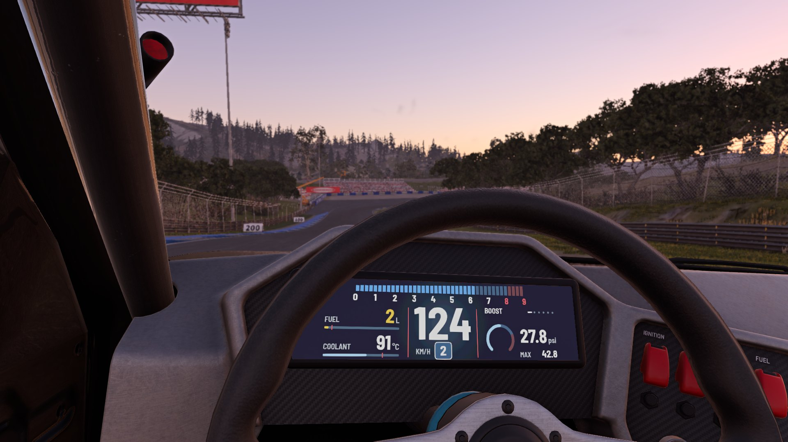
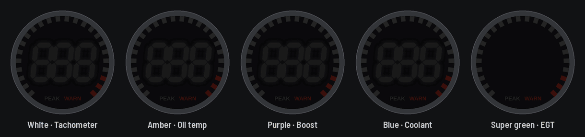
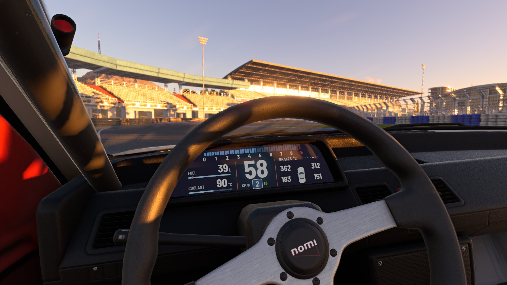
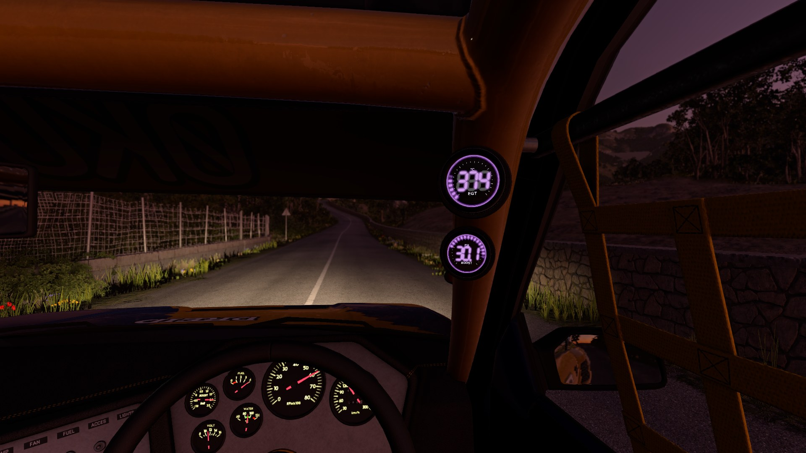
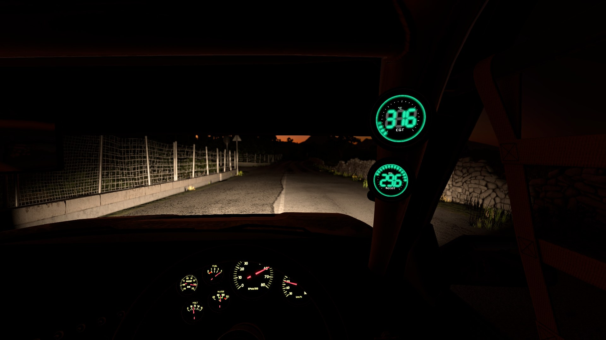

# Pillar Pod Digital Gauges

Digital gauges for BeamNG.drive. Round gauges on the A-pillar or roll cage, a pillar-mounted
multi-function display, and a full digital instrument cluster that replaces the car's own gauges.

Works on the Ibishu Covet and the Ibishu 200BX. The display and the cluster are Covet only for now.

Version 1.2.1 · [Changelog](CHANGELOG.md)

## Install

1. Download `pillar_pod_gauges_<version>.zip` from the
   [latest release](https://github.com/likeBloodMoon/Pillar-Pod-Digital-Gauges/releases/latest).
2. Put it in your BeamNG `mods` folder as it is. Do not unpack it.
3. When updating, delete the older version's zip first so the game doesn't load two copies.

GitHub's green "Download ZIP" button gives you the source code, not the mod, and won't load in the
game. Use the zip from the release.

## What's in it

### Pillar gauges (Covet and 200BX)

*Five gauge types in five colours through ignition on, a pull to full boost, lift off and ignition
off. Watch the shift light on the tach, the boost gauge's peak, and the oil gauge going red past its
warning limit.*

In the parts selector go to Additional Modification → Digital Pillar Gauges, then pick what goes in
the Lower Gauge and Upper Gauge slots. Either slot takes any gauge:

| Gauge | Shows |
|---|---|
| Boost | Vacuum and boost on a 24-LED sweep, scaled to the turbo's wastegate limit, with peak recall |
| Oil temperature | Oil temperature with a blue COLD mark until the engine is warm |
| Coolant temperature | Coolant temperature with a COLD mark and a warning limit |
| Exhaust gas temperature | EGT from the game's engine heat simulation; in °F a full 4-digit readout (1370) |
| Fuel level | Fuel left, with a low-fuel warning |
| Tachometer | Engine speed in thousands (6.8 = 6800 rpm), scaled to the engine's rev limit, with a shift light |

Under the label there are two small lights. PEAK (blue) flashes on when the reading sets a new high
for the drive near the top of the scale. WARN (red) stays on while the reading is past its limit:
overboost, overheating, low fuel, or the shift point on the tach. The fuel gauge only has WARN.

Each gauge also stores the highest reading of the drive. Bind "Gauges: show peak" and "Gauges: reset
peak" in Options → Controls: show peak puts the stored peak on the digits for 3 seconds with PEAK
in place of the label, and reset peak clears it (the gauge shows `CLr`). The display and the cluster
show their session maximums (boost, engine speed, oil, coolant and exhaust temperature, g) on the
same bindings. The fuel gauge keeps no peak.

If the car doesn't have that reading at all, say a boost gauge on a car with no turbo or
supercharger, the gauge shows `---` and leaves the LED ring dark, so you don't get a fake 0. The
display and the cluster do the same.

Every gauge uses Automatic Mounting, in black or in silver with a white face. It works out where to
sit by itself: on the A-pillar trim, on the bare pillar of a stripped or race interior, or on the
roll cage bar, in left- or right-hand drive.

### Digital cluster (Covet)

Parts selector → Gauges → Pillar Pod Digital Cluster. It swaps the Covet's instrument cluster for a
wide screen. On the standard dashboard the screen fills the old gauge opening. With the race
dashboard, pick Pillar Pod Digital Cluster (Race Dash) instead and a screen unit sits on the carbon
panel. It goes in the car's own Gauges slot, so you can run it together with the pillar gauges.

- Top: a bar tach that turns amber near the limit, red past it, and flashes at the shift point
- Middle: speed and gear, plus warning lights that only show up when they're on (parking brake,
  check engine, overheating, headlights)
- Left: fuel and coolant temperature, with bars
- Right: one page at a time: Boost, Tyres, Engine (oil and EGT), Brakes, G-Force, Trip (range,
  outside temperature, drive time)

I kept it to a few big numbers, and nothing important sits behind the steering wheel rim, so it
reads fine from the driver's seat.

### Multi-function display (Covet)

Pick Multi-Function Display for the Lower Gauge and you get a portrait colour screen on the
A-pillar in place of a round gauge (leave the Upper Gauge empty). It mounts itself on the standard
interior, the stripped interior or the roll cage, left- or right-hand drive. The pages:

- Boost: a dial scaled to the wastegate limit, with the highest boost of the session
- Tyres: pressure, tread temperature and wheel speed for each wheel. Low pressure turns amber, a
  flat turns red
- Engine: oil, coolant and exhaust gas temperature and engine speed, with warning limits
- Brakes: temperature of each brake
- G-Force: a friction circle with a trace, plus peak lateral and longitudinal g

Status rows along the top and bottom show warning lights, fuel, range, drive time, gear, outside
and coolant temperature.

### Changing pages

In the cabin, click the button under the display or the page panel on the cluster. You can also
bind "Display: next page" in Options → Controls. The display and the cluster change page together.

### Event recorder and Event History app

With any of the mod's parts fitted, the car records the moments you'd want to look at again:

| Event | When |
|---|---|
| Overboost | boost over the car's own wastegate limit |
| Rev limiter | the engine at its limiter |
| Coolant / oil overheat | coolant over 110 °C, oil over 130 °C |
| Hard braking | braking at more than 0.8 g |
| Lateral g | a corner harder than 0.9 g that beats your best of the drive |
| Impact | a crash that absorbs more than 3 kJ |
| Stall | the engine stopping while you're moving |
| Engine damage | damage the game reports: over-rev, head gasket, oil starvation, a hydrolocked engine and so on |

Each event keeps a few seconds of readings before and after it (engine speed, boost, speed,
throttle and brake, gear, temperatures, g-forces, crash energy) and a summary at its peak. Every
number comes straight from the game's simulation.

To see them, add the Pillar Pod Event History UI app from the game's app editor, like any other UI
app. Pick an event to see its summary and the readings around it. The timeline along the top shows
the whole drive. Units follow your game settings.

Save writes the drive to your BeamNG user folder, in `pillar_pod_gauges/recordings` (on
Windows: `%LOCALAPPDATA%\BeamNG\BeamNG.drive\current\pillar_pod_gauges\recordings`). The mod also
saves it a few seconds after each new event. To look at a recording on a PC, open
[`viewer/index.html`](viewer/index.html) in a browser (download it, it works offline) and drop the
file on it. There you can also switch units and download any event as CSV.

## Settings

Everything follows the game's unit settings (psi / bar / kPa, °C / °F, km/h / mph, litres /
gallons). All screens dim at night and with the headlights on.

In the Tuning menu, under Gauges:

- Colour of the round gauges' LED ring and digits: 0 green with red digits (default), 1 white,
  2 amber, 3 blue, 4 purple, 5 super green. Purple and super green also light the labels and a
  glowing rim round the face. Warnings stay red in every colour

   
- Overboost warning, peak recall time, shift light on/off
- Tachometer: shift light on/off, the RPM where it starts, scale maximum
- Oil, coolant and exhaust warning temperatures, cold-mark temperatures, low-fuel warning
- Night brightness: one setting for all the round gauges, and separate ones for the display and the
  cluster
- First page shown on the display and on the cluster
- Shut-down sweep: when the ignition is switched off, the round gauges sweep their LED ring and fade
  out and the screens fade to black (1 = on, 0 = switch off at once)

## Known limits

- The pillar gauges and the display use the car's single Additional Modification slot, so they
  can't be combined with another mod that uses that slot. The cluster uses the Gauges slot instead.

## Roadmap

Planned work is tracked as [milestones](https://github.com/likeBloodMoon/Pillar-Pod-Digital-Gauges/milestones), one per release:

- [1.3](https://github.com/likeBloodMoon/Pillar-Pod-Digital-Gauges/milestone/1): peak and warning lights on every gauge, `---` when a car
  doesn't report a reading, tachometer and G-meter gauges, key bindings to show and reset the peak,
  a shorter parts list with only automatic mounting, and new styles: colour themes (purple and super
  green included), needle faces, a smoked-lens finish and light and dark screens for the display and
  cluster
- [1.4](https://github.com/likeBloodMoon/Pillar-Pod-Digital-Gauges/milestone/2): the Pessima, Sunburst and ETK 800, the display and cluster on the 200BX,
  a triple pillar pod and other mounts, and a nitrous bottle-pressure gauge
- [1.5](https://github.com/likeBloodMoon/Pillar-Pod-Digital-Gauges/milestone/3): a race-dash cluster with a shift-light strip, a warning banner and timers,
  and a replay of the last 3 minutes on the display
- [2.0](https://github.com/likeBloodMoon/Pillar-Pod-Digital-Gauges/milestone/4): estimated readings such as oil pressure and air-fuel ratio (labelled as
  estimates on the gauge) and ready-made configs

The plan can change. Give an issue a 👍 if you want it, or post an idea in
[Discussions](https://github.com/likeBloodMoon/Pillar-Pod-Digital-Gauges/discussions). If you'd like to help, the issues labelled
[good first issue](https://github.com/likeBloodMoon/Pillar-Pod-Digital-Gauges/labels/good%20first%20issue) are the easiest to start with; see
[CONTRIBUTING.md](CONTRIBUTING.md).

## Support

The mod is free and will stay free. If you enjoy it and want to say thanks, you can
[buy me a coffee on Ko-fi](https://ko-fi.com/likebloodmoon), which buys me more evenings to work on
it. Bug reports, ideas and screenshots of your build in
[Discussions](https://github.com/likeBloodMoon/Pillar-Pod-Digital-Gauges/discussions) help a lot
too.

## For developers

- `vehicles/common/pillar_pod_gauges/`: meshes, materials, textures, fonts and the screen pages
  (`screen.html`, `mfd.html`, `cluster.html`)
- `vehicles/covet/`, `vehicles/bx/`: the parts for each car (generated by `tools/gen_jbeam.py`)
- `lua/vehicle/controller/gauges/customModules/`: automatic mounting, ambient light, wastegate
  limit, EGT and the display's data (`dbgAmbient.lua`), and the event recorder (`dbgRecorder.lua`)
- `ui/modules/apps/PillarPodEvents/`: the Event History UI app
- `viewer/`: the event viewer (`viewer.js`), shared by the UI app and the PC page `viewer/index.html`.
  Edit `viewer.js` or the templates, then run `python tools/build_viewer.py`
- `tools/`: the scripts that generate the meshes and parts, and `validate_assets.py`, which CI runs
  on every pull request

To build the mod zip yourself, zip the `vehicles`, `lua` and `ui` folders so they sit at the top
level of the zip. Pushing a `v*` tag builds the zip and attaches it to a GitHub release.

## Licence

MIT, see [LICENSE](LICENSE). The licence covers this mod's own files. BeamNG.drive and its vehicles
belong to BeamNG GmbH and are not part of this repository.

The screens use the Barlow Semi Condensed typeface by the Barlow Project Authors, under the SIL Open
Font License 1.1 (`vehicles/common/pillar_pod_gauges/fonts/OFL.txt`).
