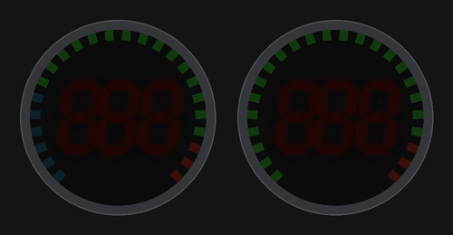

# Pillar Pod Digital Gauges

Digital gauges for BeamNG.drive. Round gauges on the A-pillar or roll cage, a pillar-mounted
multi-function display, and a full digital instrument cluster that replaces the car's own gauges.

Works on the **Ibishu Covet** and the **Ibishu 200BX**. The display and the cluster are Covet only
for now.

**Version 1.2.1** · [Changelog](CHANGELOG.md)

## Install

1. Download `pillar_pod_gauges_<version>.zip` from the
   [latest release](https://github.com/likeBloodMoon/Pillar-Pod-Digital-Gauges/releases/latest).
2. Put it in your BeamNG `mods` folder as it is. Do not unpack it.
3. When updating, delete the older version's zip first so the game doesn't load two copies.

GitHub's green "Download ZIP" button gives you the source code, not the mod, and won't load in the
game. Use the zip from the release.

## What's in it

### Pillar gauges (Covet and 200BX)

*Ignition on, a pull to full boost, lift off (the boost gauge shows the peak), ignition off.*

Parts selector → **Additional Modification** → **Digital Pillar Gauges**, then pick what goes in
the **Lower Gauge** and **Upper Gauge** positions. Each position can hold any gauge:

| Gauge | Shows |
|---|---|
| Boost | Vacuum and boost on a 24-LED sweep, scaled to the turbo's wastegate limit, with peak recall |
| Oil temperature | Oil temperature with a blue COLD mark until the engine is warm |
| Coolant temperature | Coolant temperature with a COLD mark and a warning limit |
| Exhaust gas temperature | EGT from the game's engine heat simulation; in °F a full 4-digit readout (1370) |
| Fuel level | Fuel left, with a low-fuel warning |
| Tachometer | Engine speed in thousands (6.8 = 6800 rpm), scaled to the engine's rev limit, with a shift light |

Choose **Automatic Mounting** (black, or silver with a white face) and the gauge finds its own
place: on the A-pillar trim, on the bare pillar of a stripped or race interior, or on the roll cage
bar, for left- or right-hand drive. Fixed mountings for each interior are there too if you want to
pick yourself.

### Digital cluster (Covet)

Parts selector → **Gauges** → **Pillar Pod Digital Cluster**. It replaces the Covet's instrument
cluster with a wide screen. On the standard dashboard the screen fills the old gauge opening; with
the race dashboard choose **Pillar Pod Digital Cluster (Race Dash)** and a screen unit sits on the
carbon panel. It uses the car's own Gauges slot, so it works alongside the pillar gauges.

- **Top:** bar tachometer that turns amber near the limit, red past it, and flashes at the shift point
- **Middle:** speed and gear, with warning lights only when they're on (parking brake, check
  engine, overheating, headlights)
- **Left:** fuel and coolant temperature with bars
- **Right:** one page at a time: Boost, Tyres, Engine (oil and EGT), Brakes, G-Force, Trip
  (range, outside temperature, drive time)

The layout is built to be read from the driver's seat: few readings, large numbers, and everything
inside the part of the screen the steering wheel doesn't cover.

### Multi-function display (Covet)

**Lower Gauge** → **Multi-Function Display** puts a portrait colour screen on the A-pillar instead
of a round gauge (leave the Upper Gauge empty). It mounts itself on the standard interior, the
stripped interior or the roll cage, left- or right-hand drive.

- **Boost:** dial scaled to the wastegate limit, with the session maximum
- **Tyres:** pressure, tread temperature and wheel speed per wheel; low pressure turns amber, a flat red
- **Engine:** oil, coolant and exhaust gas temperature and engine speed, with warning limits
- **Brakes:** temperature per brake
- **G-Force:** friction circle with a trace and peak lateral and longitudinal g

Status rows along the top and bottom show warning lights, fuel, range, drive time, gear, outside
and coolant temperature.

### Changing pages

Click the button under the display, or the page panel on the cluster, in the cabin. You can also
bind **Display: next page** in Options → Controls. The display and the cluster flip together.

## Settings

Everything follows the game's unit settings (psi / bar / kPa, °C / °F, km/h / mph, litres /
gallons). All screens dim at night and with the headlights on.

Tuning menu, category **Gauges**:

- Overboost warning, peak recall time, shift light on/off
- Tachometer: shift light on/off, the RPM where it starts, scale maximum
- Oil, coolant and exhaust warning temperatures, cold-mark temperatures, low-fuel warning
- Night brightness for the gauges, the display and the cluster
- First page shown on the display and on the cluster
- Shut-down sweep: when the ignition is switched off, the round gauges sweep their LED ring and fade
  out and the screens fade to black (1 = on, 0 = switch off at once)

## Known limits

- The pillar gauges and the display use the car's single **Additional Modification** slot, so they
  can't be combined with another mod that uses that slot. The cluster uses the Gauges slot instead.
- Each mounting has a pod mesh shaped to that interior, so moving a gauge by editing coordinates
  only works for small nudges.

## Roadmap

Planned work is tracked as [milestones](https://github.com/likeBloodMoon/Pillar-Pod-Digital-Gauges/milestones), one per release:

- [1.3](https://github.com/likeBloodMoon/Pillar-Pod-Digital-Gauges/milestone/1): peak and warning lights on every gauge, key bindings to show and reset
  the peak, `--` when a car doesn't report a reading, and tachometer and G-meter gauges
- [1.4](https://github.com/likeBloodMoon/Pillar-Pod-Digital-Gauges/milestone/2): the Pessima, Sunburst and ETK 800, the display and cluster on the 200BX,
  a triple pillar pod and other mounts
- [1.5](https://github.com/likeBloodMoon/Pillar-Pod-Digital-Gauges/milestone/3): a race-dash cluster with a shift-light strip, a warning banner and timers
- [2.0](https://github.com/likeBloodMoon/Pillar-Pod-Digital-Gauges/milestone/4): needle-style faces, estimated readings such as oil pressure and air-fuel
  ratio (labelled as estimates on the gauge), colour themes and ready-made configs

The plan can change. Give an issue a 👍 if you want it, or post an idea in
[Discussions](https://github.com/likeBloodMoon/Pillar-Pod-Digital-Gauges/discussions). If you'd like to help, the issues labelled
[good first issue](https://github.com/likeBloodMoon/Pillar-Pod-Digital-Gauges/labels/good%20first%20issue) are the easiest to start with; see
[CONTRIBUTING.md](CONTRIBUTING.md).

## For developers

- `vehicles/common/pillar_pod_gauges/`: meshes, materials, textures, fonts and the screen pages
  (`screen.html`, `mfd.html`, `cluster.html`)
- `vehicles/covet/`, `vehicles/bx/`: the parts for each car (generated by `tools/gen_jbeam.py`)
- `lua/vehicle/controller/gauges/customModules/`: automatic mounting, ambient light, wastegate
  limit, EGT and the display's data
- `tools/`: the scripts that generate the meshes and parts, and `validate_assets.py`, which CI runs
  on every pull request

To build the mod zip yourself, zip the `vehicles` and `lua` folders so both sit at the top level of
the zip. Pushing a `v*` tag builds the zip and attaches it to a GitHub release.

## Licence

MIT, see [LICENSE](LICENSE). The licence covers this mod's own files. BeamNG.drive and its vehicles
belong to BeamNG GmbH and are not part of this repository.

The screens use the Barlow Semi Condensed typeface by the Barlow Project Authors, under the SIL Open
Font License 1.1 (`vehicles/common/pillar_pod_gauges/fonts/OFL.txt`).
