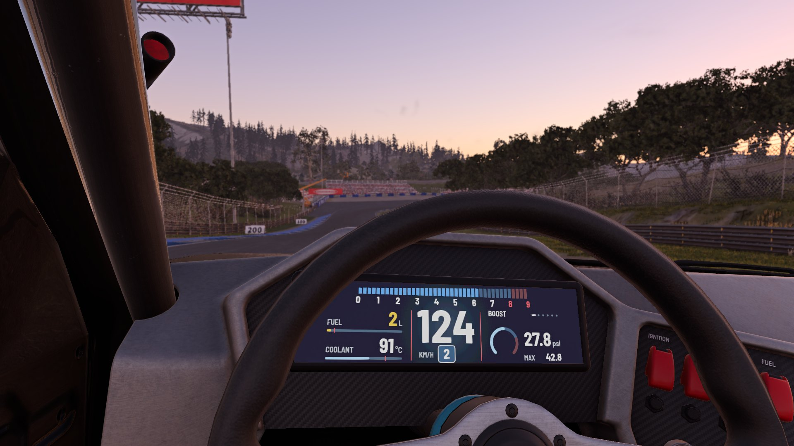
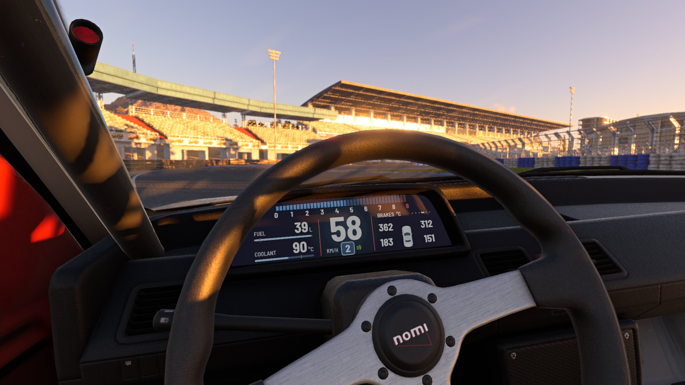

# Pillar Pod Digital Gauges

Digital gauges for BeamNG.drive: round gauges on A-pillar and roll-cage pods, a pillar-mounted
multi-function display, and a full digital instrument cluster.
Currently for the Ibishu Covet and the Ibishu 200BX (the display and the cluster are Covet only).

## Install

Download the mod zip (named after the version, for example `pillar_pod_gauges_v1.1.0.zip`) from the
[latest release](https://github.com/likeBloodMoon/Pillar-Pod-Digital-Gauges/releases/latest) and
put it in your BeamNG `mods` folder. Do not unpack it. When updating, remove the older version's
zip first so the game does not load two copies.

GitHub's own "Download ZIP" of the source will not work as a mod, because it wraps everything in
an extra folder. To build the mod zip yourself, zip the `vehicles` and `lua` folders together so
that both sit at the top level.

## Use

Parts selector → **Additional Modification** → **Digital Pillar Gauges**.

There are two positions, **Lower Gauge** and **Upper Gauge**. Each can hold any of the gauge
types: boost, oil temperature, coolant temperature, exhaust gas temperature (EGT) or fuel level. By default the lower one is boost
and the upper one is empty.

Every gauge type comes with **Automatic Mounting** in black or silver (silver bezel, white face).
It looks at the car's interior and puts the gauge in the right place: on the A-pillar trim, on the
bare pillar of a stripped / race / rally interior, or on the roll cage bar, for left- or right-hand
drive. Boost (lower) and oil temperature (upper) are also offered in fixed mountings, one per
interior type, if you want to choose yourself.

On the 200BX the A-pillar has the same shape with every interior, coupe or liftback, so there is
one pillar mounting plus the roll cage one. With the derby cage, which has no bar along the
A-pillar, the gauges stay on the pillar.

## Digital cluster (Covet)

**Gauges → Pillar Pod Digital Cluster** replaces the Covet's instrument cluster with a wide screen,
using the car's own Gauges slot, so it combines with anything in Additional Modification. On the
standard dashboard the screen takes the exact shape of the old gauge face; on the race dashboard
(**Pillar Pod Digital Cluster (Race Dash)**) a screen unit sits on the carbon panel, inside the
steering wheel's view. Left- and right-hand drive.

- Middle: speed, gear, and a bar tachometer that turns amber near the limit and flashes at the shift point
- Left: fuel with level bar, coolant temperature, range, outside temperature and time
- Right: one page of the multi-function display (boost, tyres, engine, brakes, g-force). Touch the
  page panel in the cabin, or use the **Display: next page** binding, to flip pages
- First page and night brightness are in the Tuning menu

The layout keeps everything inside the part of the cluster the driver can see past the steering
wheel rim.

## Multi-function display (Covet)

**Lower Gauge → Multi-Function Display** puts a portrait colour screen on the A-pillar instead of the
round gauges (leave the Upper Gauge empty). It has five pages:

- **Boost:** dial scaled to the turbo's wastegate limit, with the session maximum
- **Tyres:** pressure, tread temperature and wheel speed per wheel; low pressure turns amber, a flat red
- **Engine:** oil, coolant and exhaust gas temperature and engine speed, with their warning limits
- **Brakes:** temperature per brake
- **G-Force:** friction circle with a trace and the peak lateral and longitudinal g

The status rows show warning lights, fuel, estimated range (from the fuel used since spawning),
time since the ignition came on, the gear, outside and coolant temperature.

Change page by clicking the button under the screen in the cabin, or bind **Display: next page**
in the controls. The first page and night brightness are in the Tuning menu.

Like the gauges, it mounts itself to suit the standard interior, the stripped interior or the roll
cage, for left- or right-hand drive. The 200BX doesn't have it yet.

## Features

- Live display with a 24-LED sweep: vacuum in blue, boost in green, red overboost zone
- LED scale and overboost warning set themselves from the turbo's wastegate limit
- Peak recall after each pull, start-up sweep, reads zero with the engine stopped
- Shift light: the whole LED ring flashes red near the rev limit
- Coolant temperature, exhaust gas temperature and fuel level gauges, alongside boost and oil
  temperature. EGT comes from the game's engine heat simulation; in °F it reads in hundreds
  (13.7 = 1370 °F) because the display has three digits
- Blue COLD mark on the temperature gauges until the engine is warm; low-fuel warning on the fuel gauge
- PSI / bar / kPa and °C / °F follow the game's unit settings
- Dims automatically at night and with the headlights on
- Tuning menu sliders (category **Gauges**): overboost warning, peak recall time, shift light
  on/off, night brightness, oil, coolant and exhaust warning temperatures, cold-mark temperatures, low-fuel warning

## Known limits

- It uses each car's single "Additional Modification" slot, so it cannot be combined with another
  mod that uses that slot.
- The right-hand-drive mountings are mirrored from the left-hand ones. On the 200BX they were
  checked against the right-hand dashboards' meshes, but not yet in game.
- Each mounting has its own pod mesh shaped to that interior, so moving a gauge by editing
  coordinates only works for small nudges.

## Layout

- `vehicles/common/pillar_pod_gauges/` — meshes, materials, face textures and the display page
- `vehicles/covet/`, `vehicles/bx/` — the parts for each car
- `lua/vehicle/controller/gauges/customModules/` — ambient light, wastegate limit and automatic
  mounting
- `tools/` — the scripts the generated files came from

## Licence

The display uses the Barlow Semi Condensed typeface by the Barlow Project Authors, under the SIL Open Font
License 1.1 (`vehicles/common/pillar_pod_gauges/fonts/OFL.txt`).

MIT, see [LICENSE](LICENSE). The licence covers this mod's own files. BeamNG.drive and its
vehicles belong to BeamNG GmbH and are not part of this repository.
